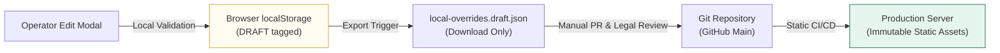

# Operator Security & Data Integrity Assessment: VISABLE R2

**Date**: 2026-10-19  
**Service**: VISABLE (`/immigration-checklists.html`)  
**Scope**: Content Maintenance Dialog, Local Storage Subsystem, JSON Exporter, DOM Sanitization  
**Auditor**: Independent Application Security & Governance Reviewer  
**Status**: **SECURE — NON-PUBLISHING GUARANTEE VERIFIED**

---

## 1. Security Architecture & Threat Model

VISABLE provides a dual-interface architecture:
- **Public Foreign Resident Interface**: Clean, unencumbered 4-step guided checklist.
- **Content Maintainer / Operator Mode**: In-browser draft editing, diff preview, and JSON export for immigration researchers.

Because immigration requirements have real legal consequences, the primary threat model centers on **unauthorized tampering, inadvertent misinformation publication, and client-side code injection**.



---

## 2. Core Security & Integrity Guarantees

### A. Non-Publishing Guarantee (Zero Server Mutation)
- **Zero API Endpoints**: VISABLE has no backend API endpoints capable of modifying server-side files from the browser.
- **Isolated Client State**: Drafts edited in the modal persist exclusively in the user's local `localStorage` keys:
  - `visable.checklists.nationalDrafts.v1`
  - `visable.checklists.officeDrafts.v1`
- **Draft Tagging Policy**: Exported office overrides are permanently tagged with:
  ```json
  "review_state": "DRAFT",
  "policy": "DRAFT entries are never rendered publicly. Verification and review state promotion required."
  ```
- **Code Review Gate**: Changes can only reach production through a standard GitHub pull request subject to automated tests, data integrity scripts, and senior legal review.

---

### B. Mandatory Evidentiary Audit Trail
To prevent unsubstantiated claims from entering local drafts:
1. **Mandatory Note Field**: Saving any draft requires a non-empty `editor_note` (e.g. `2026.10 서울출입국 공식 공지사항 대조 확인`). Submitting without notes is blocked with an alert.
2. **Strict HTTPS URL Enforcement**: For jurisdictional office differences, evidence URLs must match `^https://` or save is aborted.
3. **Real-time Live Diff Preview**: The R2 release introduces an in-modal diff preview (`#edit-diff-container`) that automatically compares edited text against the original baseline line-by-line, displaying additions (`+ 수정:`) and removals (`- 원본:`) before commit.

---

### C. DOM Injection & Cross-Site Scripting (XSS) Defenses
1. **Safe DOM Construction**: The application relies strictly on a safe element builder:
   ```javascript
   function element(tag, className, text) {
     var el = document.createElement(tag);
     if (className) el.className = className;
     if (text) el.textContent = text; // Never innerHTML
     return el;
   }
   ```
2. **Adversarial Verification**: Automated tests injected malicious payload `` into textareas. The test confirmed zero script execution (`window.__xss === 0`), with tags rendered harmlessly as plain text.

---

### D. Operator UI Demarcation
- **Public Cleanliness**: Operator tools (JSON export buttons, raw line numbers) remain concealed from standard users.
- **Explicit Activation**: Operators can toggle maintainer controls via the top navigation pill (`#operator-mode-toggle`) or by navigating to `#operator`.
- **Accessible State Announcement**: Maintainer controls feature proper ARIA roles and labels (`aria-expanded`, `aria-label="E-7-1 특정활동 문구 편집"`).

---

## 3. Automated Security Test Results

All operator security assertions are continuously verified in the CI/CD pipeline:

| Test Assertion | Test Specification | Result |
|---|---|:---:|
| Evidence note mandatory | `user local drafts require evidence notes...` | **PASS** |
| Office draft tagged DRAFT | `user local drafts require evidence notes...` | **PASS** |
| National draft export file name | `national wording edits never write to server...` | **PASS** |
| XSS injection immunity | `untrusted strings are rendered as text only` | **PASS** |
| Live diff preview tracks edits | `office selection transparency and live editor diff preview...` | **PASS** |
| Local storage reload persistence | `national wording edits never write to server...` | **PASS** |

---

## 4. Assessment Summary

The operator tooling in VISABLE R2 achieves complete isolation between local editorial experimentation and immutable production information. No privilege escalation or public misinformation path exists within the client application.
