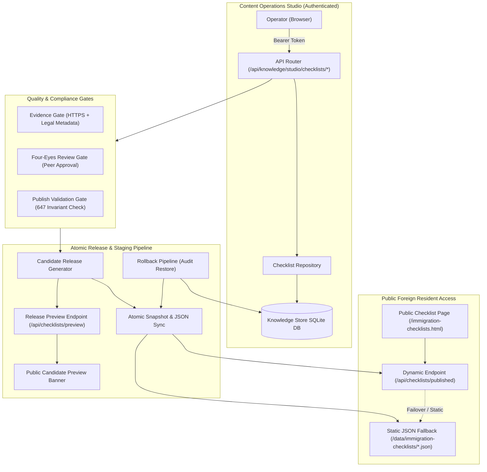

# VISABLE R3.1: Publication & Rollback Architecture
## Atomic Publishing Pipeline, Preview Verification & Disaster Recovery

- **Milestone**: VISABLE R3.1 (Production Publishing Recovery, Data Integrity & Operational Readiness)
- **Branch**: `feat/visable-r3-1-publishing-recovery`
- **Date**: 2026-10-20
- **Architect**: Principal Full-Stack Engineer & Release Architect
- **Status**: Production Audit Ready

---

## 1. System Overview & Deployment Topology

VISABLE operates on a hybrid architecture designed for maximum resilience, sub-millisecond public edge serving, and verifiable administrative governance:

---

## 2. End-to-End Publication Lifecycle

### Phase 1: Draft Creation & Legal Evidence Grounding
1. An **Editor** selects any of the 647 canonical scenarios (e.g. `e-D2-01`, `c-E71-01`, `r-F4-01`).
2. The editor enters proposed modifications (plain-language guidance, mandatory items, conditional items, exceptions, proxy eligibility).
3. The editor grounds the proposed change in **Official Administrative Evidence**:
   - `evidence_url`: Must be a valid `https://` link (Hikorea, Ministry of Justice, etc.).
   - `evidence_title`: Name of regulation/guideline.
   - `evidence_issuer`: Official issuing body (e.g., 법무부 출입국·외국인정책본부).
   - `evidence_date`: Publication date.
   - `source_edition`: Manual edition (e.g., 2026.10 개정판).
   - `source_section`: Section/Chapter.
   - `source_locator`: Page number or official decree number.
   - `effective_start` / `effective_end`: Statutory effective window.
4. The draft is recorded in SQLite with status `PENDING_REVIEW`.

### Phase 2: Diff Inspection & Four-Eyes Peer Review
1. A **Reviewer** (independent operator) inspects the draft in the Review Queue.
2. The UI renders an interactive visual diff highlighting added, modified, and deleted lines.
3. An administrative impact notice warns of potential legal repercussions.
4. **Four-Eyes Enforcement**: If the reviewer is identical to the author, direct approval is prohibited by default (`HTTP 409 Conflict: Cannot approve draft authored by same operator`).
5. Only upon independent review approval is the draft status transitioned to `APPROVED`.

### Phase 3: Pre-Publish Invariant Validation Gate
Prior to releasing any batch of changes, the system executes an automated invariant check (`POST /publish/validate`):
- **Total Count**: Exact verification that total scenario count equals 647.
- **Procedure Distribution**:
  - `extension`: exactly 224 scenarios.
  - `change`: exactly 251 scenarios.
  - `registration`: exactly 172 scenarios.
- **Identifier Integrity**: Regex validation ensuring canonical ID prefixes (`^e-[A-Z0-9\-]+$`, `^c-[A-Z0-9\-]+$`, `^r-[A-Z0-9\-]+$`).
- **Cryptographic Hash**: Generation of a deterministic SHA-256 checksum over the entire sorted dataset.
- **Durability Indicator**: Distinguishes whether the backend is operating in durable storage mode or in-memory test mode.

### Phase 4: Candidate Release & Interactive Staging Preview
1. The **Publisher** triggers release execution with a semantic tag (e.g., `rel-20261020-01`) and release notes.
2. The system creates a `ReleaseRecord` and archives a pre-release baseline snapshot.
3. A **Candidate Preview URL** is generated:
   `/immigration-checklists.html?preview_release=rel-20261020-01`
4. When loaded with `preview_release`, the public frontend:
   - Fetches the candidate dataset directly from `/api/checklists/preview?release_id=rel-20261020-01`.
   - Renders a prominent persistent top banner:
     `🔍 [후보 릴리스 미리보기 모드: rel-20261020-01] 운영 배포 전 최종 검증 중입니다.`
   - Allows stakeholders to test the end-to-end foreign resident user journey before final activation.

### Phase 5: Atomic Persistence & Public Static Sync
1. For durable deployments, the repository writes the updated dataset atomically to disk:
   - `data/immigration-checklists/extension-202609.json`
   - `data/immigration-checklists/change-202609.json`
   - `data/immigration-checklists/registration-202609.json`
2. The public dynamic endpoint (`/api/checklists/published`) immediately serves the latest published version.
3. If the backend is unavailable or during static edge rendering on Vercel, the frontend automatically falls back to the static JSON files, guaranteeing zero downtime.

---

## 3. Emergency Rollback Architecture

If an unexpected administrative discrepancy or legal defect is detected post-publication:

1. **Rollback Trigger**:
   A Publisher clicks **롤백 (Rollback)** on the target release in the Content Studio Release History table.
2. **Mandatory Audit Rationale**:
   The operator must provide an auditable justification (e.g., "법무부 2026-10-20 긴급 정정고시 반영에 따른 원복").
3. **Snapshot Restoration**:
   The backend retrieves the pre-release snapshot recorded before that release was applied.
4. **State Transition**:
   - The target release record status is updated to `ROLLED_BACK`.
   - The checklist items are restored to their exact pre-release baseline.
   - If durable storage is active, the static JSON files are re-emitted with the restored records.
5. **Audit Trail**:
   A permanent audit event is written to the SQLite log containing the operator name, role, timestamp, target release ID, and explanation.

---

## 4. Resilience & Fallback Matrix

| Failure Mode | Detection | System Behavior & Mitigation |
|---|---|---|
| **Backend API Unreachable** | `fetch('/api/checklists/published')` fails / 404 / 503 | Frontend catches error, falls back seamlessly to static JSON files in `/data/immigration-checklists/`. Zero impact on public users. |
| **Missing Scenario in Release** | Pre-publish validator checks item counts | Release blocked with HTTP 422 before any mutation occurs. Count must equal 647. |
| **In-Memory Test Run** | `store.durable == False` | Repository suppresses filesystem export, preventing test fixtures from mutating production git worktree. |
| **Illegal Self-Approval** | Reviewer token matches draft author | HTTP 409 Conflict returned; UI presents warning requiring distinct reviewer sign-off. |
| **Erroneous Release Published** | Post-release monitoring | Publisher initiates 1-click rollback via `/releases/{id}/rollback`, restoring baseline from snapshot. |
