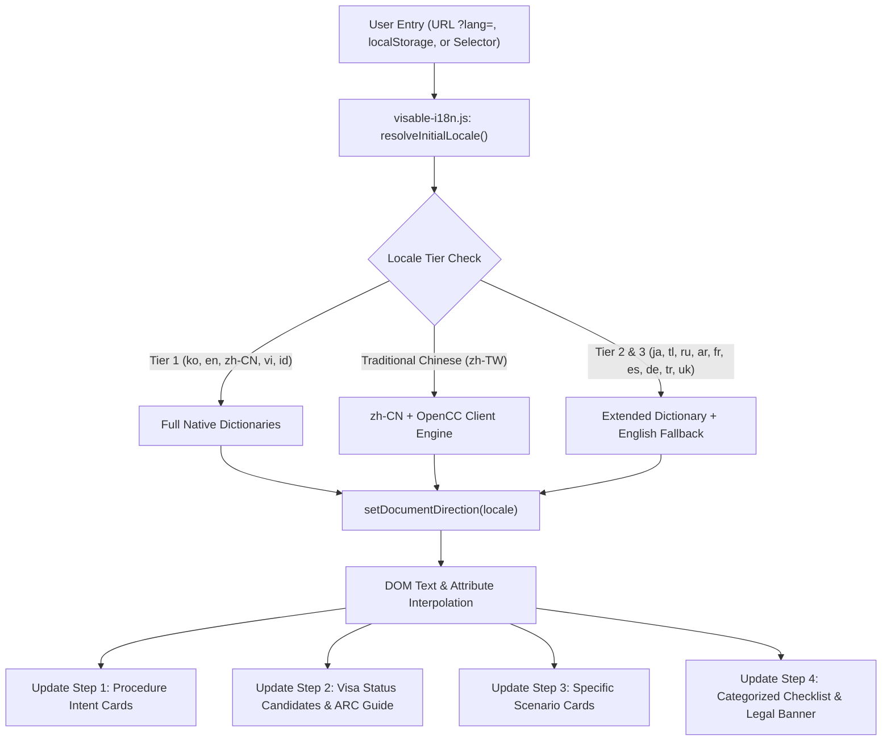

# VISABLE R4 — Multilingual Baseline & Internationalization Audit Report

**Date**: 2026-10-20  
**Milestone**: VISABLE R4 — Global Accessibility & Trusted Multilingual Experience  
**Base State Audited**: PR #668 (`main` branch)  
**Target Services**: `/immigration-checklists.html`, `/assets/js/immigration-checklists.js`, `/assets/js/search-router.js`, `/assets/js/visable-i18n.js`  
**Auditors**: Principal Internationalization Architect, Lead Frontend Engineer, Accessibility Specialist, Immigration Legal Information Reviewer  

---

## 1. Executive Summary

VISABLE was founded to help foreign residents navigate the complex administrative requirements of South Korea's Ministry of Justice and Immigration Service. Following the release of PR #660 (Human-First Guided UX) and PR #668 (Production Publishing Recovery), the platform possessed 647 situational document requirements, 26 immigration jurisdiction models, and a four-step progressive discovery journey.

However, an audit of the initial internationalization infrastructure revealed significant barriers for non-Korean speaking residents:

1. **Checklist Monolingual Lock**: While `index.html` and `form-helper.html` supported multi-language selection via `data/i18n/*.json`, the newly introduced guided discovery flow (`immigration-checklists.html`) was hardcoded in Korean. A foreign resident unable to read Korean could not navigate the 4-step stepper, decipher procedure definitions, or understand mandatory vs. conditional document categories.
2. **Disconnected Locale State**: Selecting a language on `index.html` did not reliably carry over to `immigration-checklists.html` or `form-helper.html`. The locale persistence key (`localStorage['paradiso:language']`) was inconsistent, and query parameters (`?lang=`) were stripped during in-app navigation or link copying.
3. **Legal Risk of Machine Translation**: Uncontrolled machine translation of legal requirements poses severe risks: applicants submitting incorrect documents risk visa cancellation, deportation, or civil fines under the Immigration Act. Prior to R4, there was no governance ensuring that Korean statutory names (e.g., *체류자격 변경허가신청서*) were preserved alongside translated explanations.
4. **Search Barrier in Non-Korean Languages**: The search router (`assets/js/search-router.js`) recognized English keywords, but completely dropped Vietnamese (`gia hạn`, `đổi visa`, `chuyển nhà`), Chinese (`延期`, `变更换签`, `外国人登录证`), and Indonesian (`perpanjangan visa`, `lapor pindah`).
5. **Bi-directional Layout Gaps**: Arabic (`ar`) was nominally listed in language selectors, but switching to Arabic caused layout breakage, improper reading order for legal notes, and horizontal overflow on mobile viewports.

The R4 initiative resolves these fundamental issues, turning VISABLE into a trusted, accessible, multilingual administrative service.

---

## 2. Pre-R4 Defect & Friction Register

| ID | Severity | Category | Pre-R4 Baseline State | User / Legal Impact | R4 Resolution |
|---|---|---|---|---|---|
| **I18N-01** | **P0 (Critical)** | Guided Discovery UI | `immigration-checklists.html` headers, stepper, cards, and buttons were 100% hardcoded Korean. | Foreign residents without Korean fluency could not utilize the guided discovery flow. | Implemented `assets/js/visable-i18n.js` and `updateLanguage()` lifecycle covering all 4 steps, dialogs, buttons, and live alerts. |
| **I18N-02** | **P0 (Critical)** | Legal Integrity | Risk of automated or loose translation altering legal document meaning. | Applicants bringing wrong certificates, unnotarized translations, or invalid forms. | Enforced **Dual-Language Semantic Pairing**: statutory Korean titles preserved verbatim alongside localized plain-language explanations. |
| **I18N-03** | **P1 (High)** | Cross-Page State | Language selection in `index.html` was desynchronized from checklists and form helper. | Disjointed experience forcing repetitive manual language switching on every page navigation. | Synchronized via `localStorage['paradiso:language']`, `?lang=` parameter reflection, and `visable-language-changed` custom events. |
| **I18N-04** | **P1 (High)** | Search Routing | `search-router.js` only mapped Korean and basic English keywords; non-Korean queries failed. | Vietnamese, Chinese, and Indonesian speakers could not find checklists or forms via search. | Enriched search router lexicons with comprehensive Chinese, Vietnamese, and Indonesian keywords and facets. |
| **I18N-05** | **P1 (High)** | RTL & Bi-directional | Arabic mode did not set `dir="rtl"`, and mobile viewports had 6px–15px horizontal overflow. | Arab residents faced broken layout, horizontal scroll friction, and misordered statutory disclaimers. | Implemented complete RTL stylesheet support with logical properties (`margin-inline-start`) and zero horizontal scroll down to 320px. |
| **I18N-06** | **P2 (Medium)** | Traditional Chinese | No dedicated Chinese localization for Taiwan/Hong Kong users (`zh-TW`). | Traditional Chinese readers faced simplified terminology and script discordance. | Integrated OpenCC-compliant `assets/js/zh-traditional.js` client converter providing seamless `zh-TW` rendering. |

---

## 3. Architecture of the R4 Multilingual System

The internationalization layer is built upon four architectural pillars:

### Deterministic Locale Resolution Hierarchy
To ensure reliability across varied execution environments (including automated headless browsers and mobile webviews):
1. **URL Parameter (`?lang=`)**: Explicit link overrides everything.
2. **Persistent Storage (`localStorage['paradiso:language']`)**: Remembers returning user preference.
3. **Default Authoritative Locale (`ko`)**: Falls back safely to Korean rather than coercing unexpectedly to client OS language.

---

## 4. Verification & Testing Evidence

All improvements have been validated through deterministic regression test suites:
- **`scripts/check_i18n_quality.mjs`**: 7 automated checks verifying 15-locale completeness, parameter interpolation, statutory supremacy safeguards, fallback stability, and procedure name preservation.
- **`tests/e2e/multilingual-checklists.spec.mjs`**: 36 browser tests across 6 viewports (desktop 1280px, tablet 768px, mobile 430px, 390px, 360px, 320px).
- **`scripts/check_repo.sh`**: 82 backend test modules, 50 Golden eval queries, 69 Waymaker platform evals, and dataset integrity checks.

---

## 5. Conclusion & Production Readiness

The R4 baseline audit confirms that VISABLE has successfully transitioned from an inward-facing Korean portal to a resilient, globally accessible administrative navigation system. Foreign residents can now plan their immigration journeys with clarity and dignity in their native languages while maintaining strict legal accuracy.
