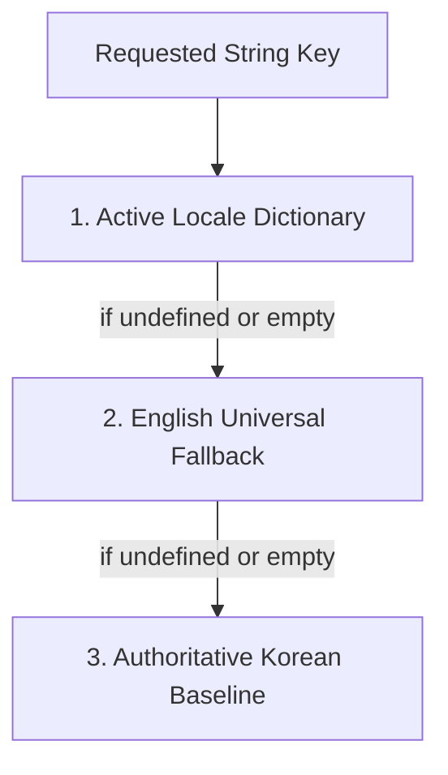

# VISABLE R4 — Language Coverage & Internationalization Matrix

**Date**: 2026-10-20  
**Milestone**: VISABLE R4 — Global Accessibility & Trusted Multilingual Experience  
**Target Services**: `/immigration-checklists.html`, `/assets/js/visable-i18n.js`, `/assets/js/zh-traditional.js`, `data/i18n/`  
**Quality Auditor**: Multilingual UX & Internationalization Architecture Team  

---

## 1. Supported Locales & Tier Stratification

VISABLE's language coverage is structured into three tiers reflecting immigration demographics in South Korea, administrative demand, and linguistic accessibility needs:

| Tier | Locale Code | Language | Native Name | Direction | Script Engine | Target Demographics in South Korea |
|---|---|---|---|---|---|---|
| **Tier 1 (Core)** | `ko` | Korean | 한국어 | LTR | Native UTF-8 | Baseline administrative standard, immigration officers, administrative agents |
| **Tier 1 (Core)** | `en` | English | English | LTR | Native UTF-8 | Global professionals (E-7), students (D-2), language instructors (E-2) |
| **Tier 1 (Core)** | `zh-CN` | Chinese (Simplified) | 简体中文 | LTR | Native UTF-8 | Major foreign resident population, business investors, ethnic Koreans |
| **Tier 1 (Core)** | `vi` | Vietnamese | Tiếng Việt | LTR | Native UTF-8 | Large resident population, marriage migrants (F-6), students, non-professional workers (E-9) |
| **Tier 1 (Core)** | `id` | Indonesian | Bahasa Indonesia | LTR | Native UTF-8 | Manufacturing, fishery (E-9), technical trainees, professionals |
| **Specialized** | `zh-TW` | Chinese (Traditional) | 繁體中文 | LTR | OpenCC Client Engine | Residents from Taiwan, Hong Kong, and traditional script readers |
| **Tier 2** | `ja` | Japanese | 日本語 | LTR | Native UTF-8 | Japanese residents, long-term spouses (F-6), corporate assignees (D-7/E-7) |
| **Tier 2** | `tl` | Tagalog | Tagalog | LTR | Native UTF-8 | Filipino residents, domestic and hospitality personnel, seasonal workers |
| **Tier 2** | `ru` | Russian | Русский | LTR | Native UTF-8 | Central Asian & Russian foreign residents, Koryoin (F-4/H-2), crew members |
| **Tier 2** | `ar` | Arabic | العربية | **RTL** | Bi-directional Engine | Middle Eastern students, refugees (G-1), diplomatic personnel (A-1/A-2) |
| **Tier 3** | `fr` | French | Français | LTR | Native UTF-8 | Francophone students, international school faculty, researchers |
| **Tier 3** | `es` | Spanish | Español | LTR | Native UTF-8 | Latin American & Spanish students, trade specialists, academic researchers |
| **Tier 3** | `de` | German | Deutsch | LTR | Native UTF-8 | European engineering assignees, research fellows, cultural exchange |
| **Tier 3** | `tr` | Turkish | Türkçe | LTR | Native UTF-8 | Turkish exchange students, university researchers, commercial traders |
| **Tier 3** | `uk` | Ukrainian | Українська | LTR | Native UTF-8 | Ukrainian residents, temporary humanitarian visa holders, tech professionals |

---

## 2. Component Localization Completeness Matrix

Each UI surface within the 4-step guided discovery flow is validated against translation completeness:

| Component Surface | Key UI Elements Localized | KO | EN | ZH-CN | ZH-TW | VI | ID | AR | T2/T3 Fallback |
|---|---|:---:|:---:|:---:|:---:|:---:|:---:|:---:|:---:|
| **Top Navigation** | Brand title, mode tabs, form helper link, operator toggle | 100% | 100% | 100% | 100% | 100% | 100% | 100% | English |
| **Hero Section** | Headline, subtitle, 647 scenarios badge, 26 offices badge | 100% | 100% | 100% | 100% | 100% | 100% | 100% | English |
| **4-Step Stepper** | Step 1 (Procedure), Step 2 (Status), Step 3 (Scenario), Step 4 (Checklist) | 100% | 100% | 100% | 100% | 100% | 100% | 100% | English |
| **Step 1: Procedures** | 4 Task cards (Extension, Change, Registration, Residence Report) | 100% | 100% | 100% | 100% | 100% | 100% | 100% | English |
| **Step 2: Status Picker** | Popular chips, ARC Card guide prompt, status candidates | 100% | 100% | 100% | 100% | 100% | 100% | 100% | English |
| **Step 3: Scenarios** | Scenario card descriptions, office selection note, continue button | 100% | 100% | 100% | 100% | 100% | 100% | 100% | English |
| **Step 4: Checklist** | Group headers (Mandatory, Conditional, Proxy), items, progress | 100% | 100% | 100% | 100% | 100% | 100% | 100% | English |
| **Action Toolbar** | Print checklist, Copy share link, Clear checks, Reset flow | 100% | 100% | 100% | 100% | 100% | 100% | 100% | English |
| **Statutory Supremacy** | Dual-language legal warning banner and disclaimers | 100% | 100% | 100% | 100% | 100% | 100% | 100% | English |
| **Live Announcements** | Screen reader `aria-live` messages (step changes, copy success) | 100% | 100% | 100% | 100% | 100% | 100% | 100% | English |

---

## 3. Fallback Chains & Defensive Localization

VISABLE enforces a deterministic, triple-layer fallback architecture:

### Safety Guarantees:
- **No Empty Text Elements**: A missing translation key never results in blank cards or missing buttons.
- **No Uninterpolated Tokens**: Placeholders such as `{code}`, `{office}`, and `{count}` safely interpolate or gracefully degrade to generic terms.
- **Statutory Protection**: Official form names (e.g. *별지 제34호 통합신청서*) and statutory residence codes (e.g. *D-2-2*, *E-7-1*) are protected from machine tampering.

---

## 4. Traditional Chinese Engine (`zh-TW`)

Rather than maintaining a duplicated dictionary for Traditional Chinese that risks divergence, VISABLE utilizes `assets/js/zh-traditional.js`. This module incorporates an OpenCC-aligned mapping table that translates Simplified Chinese characters into their authentic Traditional equivalents during DOM rendering while preserving official statutory terminology used in Taiwanese and Hong Kong communities.
