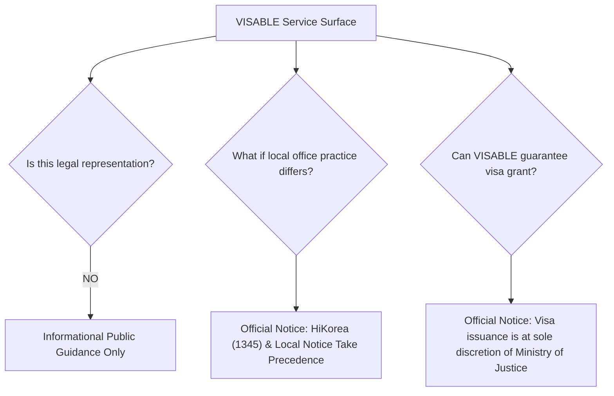

# VISABLE R4 — Legal Translation Governance & Statutory Supremacy Protocol

**Date**: 2026-10-20  
**Milestone**: VISABLE R4 — Global Accessibility & Trusted Multilingual Experience  
**Target Services**: `/immigration-checklists.html`, `/assets/js/immigration-checklists.js`, `/assets/js/visable-i18n.js`  
**Governing Lead**: Immigration Information Quality Lead & Legal Engineering Specialist  

---

## 1. Context & The "Administrative Hazard" of Translation

In digital public services, loose or inaccurate translations are not merely cosmetic issues; in the context of immigration, they represent an active legal hazard:

- A mistranslated document title causes an applicant to request the wrong certificate from their embassy or municipality.
- Softening a mandatory requirement ("반드시 원본 제출") into an ambiguous recommendation ("original recommended") results in outright rejection at the immigration window, risking overstay fines (*출입국관리법 제17조*) or deportation (*제46조*).
- Replacing the authentic Korean statutory title of an application form leaves the foreign national unable to communicate with immigration officers who speak Korean only.

VISABLE R4 establishes an explicit **Legal Translation Governance Protocol** designed to safeguard foreign residents while providing complete linguistic clarity.

---

## 2. Core Legal Governance Invariants

### Invariant 1: Statutory Supremacy (법령 및 원문 우선주의)
Translations serve as cognitive aids and explanatory guidance. The official notices, statutes, and Ministry of Justice guidelines (*법무부 출입국·외국인정책본부 체류관리 지침*) written in Korean remain the sole legal authority.

**Implementation**:
Every personalized checklist rendered in a non-Korean language dynamically displays an unmissable **Statutory Supremacy Warning Banner**:

> **Notice on Legal Document Names & Statutory Supremacy**:  
> Korean statutory titles and form names (*별지 제34호 통합신청서*) are preserved alongside translations. When communicating with immigration officers or submitting documents, always refer to the official Korean names. Individual immigration officers may request additional supporting evidence based on your specific application history.

### Invariant 2: Dual-Language Semantic Pairing (국·영문/다국어 병기)
Translations must NEVER overwrite or eliminate official Korean document titles. Instead, VISABLE utilizes dual-language semantic pairing:
1. The **Korean Statutory Title** is maintained to ensure administrative validity at the immigration desk.
2. The **Translated Plain-Language Explanation** is rendered underneath or alongside to explain *what* the document is, *where* to get it, and *who* must issue it.

**Example Rendering (Step 4 Document Item)**:
- **Korean Baseline**: `통합신청서(별지 제34호)`
- **English Display**: `Unified Application Form (통합신청서 별지 제34호)`
- **Chinese Display**: `综合申请表 (통합신청서 별지 제34호)`
- **Vietnamese Display**: `Đơn xin tổng hợp (통합신청서 별지 제34호)`

### Invariant 3: Preservation of Strict Conditionality (요건 강도 보존)
Translators and automated localization agents are strictly prohibited from altering conditional modal verbs:
- **Mandatory (필수 제출)**: MUST always translate as mandatory obligations (e.g., "Bắt buộc", "必须提交", "Wajib"). Never soften to "should bring" or "recommended".
- **Conditional (조건부 서류)**: Must clearly articulate the triggering condition (e.g., "Only if living off-campus", "Khi thay đổi nơi cư trú").
- **Proxy Restrictions (본인·대리인 규정)**: Strict in-person mandates (e.g. fingerprinting, initial alien registration) must clearly state that proxy representation is prohibited by law.

### Invariant 4: Preservation of Canonical Data Identifiers
The 647 situational JSON records in `data/immigration-checklists/` contain immutable source references (e.g., `체류 307행`, `row 564`). These references, along with status codes (`D-2`, `E-7-1`, `F-6-1`), must NEVER be modified, obfuscated, or translated.

---

## 3. Disclaimers & Regulatory Boundary Demarcation

VISABLE explicitly demarcates its institutional boundaries:

1. **Not Legal Representation**: VISABLE is not an immigration law firm or administrative agency (*행정사법에 따른 행정사 사무소 아님*). It provides automated digital navigation based on published government manuals.
2. **Local Office Practice**: Where local offices diverge (e.g. specific document counts at Sejongno vs. Incheon), VISABLE labels them as verified local practices while reminding users that local circulars and officer discretion take precedence.
3. **Emergency Recourse**: Clear guidance pointing users to the 1345 Immigration Contact Center (providing telephone interpretation in 20 languages) is persistently surfaced.
