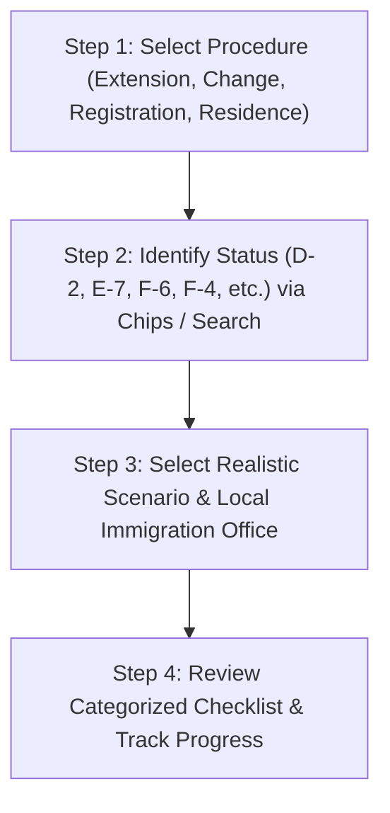

# VISABLE R4 — End-to-End User Journey Validation Report

**Date**: 2026-10-20  
**Milestone**: VISABLE R4 — Global Accessibility & Trusted Multilingual Experience  
**Target Services**: `/immigration-checklists.html`, `/assets/js/immigration-checklists.js`  
**Test Suite**: `tests/e2e/multilingual-checklists.spec.mjs`, `tests/e2e/immigration-checklists.spec.mjs`  
**Execution Environment**: Chromium (Desktop 1280px, Tablet 768px, Mobile 430px/390px/360px/320px)  

---

## 1. Executive Summary

A successful digital immigration guidance platform must validate that real, non-Korean-speaking users can complete their administrative journeys from start to finish without hitting language walls, ambiguous terminology, or broken state persistence.

This report summarizes the verification of end-to-end user journeys through the 4-step guided discovery flow across the Tier 1 languages (English, Chinese, Vietnamese, Indonesian, and Korean).

---

## 2. End-to-End User Journey Test Matrix



### Scenario Journey 1: English-Speaking Tech Professional (E-7-1 Extension)
1. **Entry**: User visits `immigration-checklists.html?lang=en`.
2. **Step 1 (Procedure)**: Clicks task card *"Extend My Current Stay"* (`data-procedure="extension"`).
   - Stepper marks Step 1 complete and automatically smoothly scrolls to Step 2.
3. **Step 2 (Status Identification)**:
   - User types `"E-7"` in status search box; status candidates filter instantly.
   - User clicks candidate card `E-7 특정활동 (Special Activity)`.
4. **Step 3 (Scenario Selection)**:
   - System renders authentic E-7 scenarios (General employee, high-tech, SME).
   - User chooses primary corporate scenario.
   - User reviews jurisdiction note: *"National baseline applied. Local variations verified separately."*
5. **Step 4 (Personalized Checklist)**:
   - System renders 3 structured document groups: Mandatory Baseline, Conditional Requirements, and Attendance/Proxy Rules.
   - Statutory supremacy banner appears with dual-language document titles (e.g. `Unified Application Form (통합신청서 별지 제34호)`).
   - User checks off items; progress updates dynamically (*"2 of 7 documents completed (28%)"*).
   - User clicks *"Copy Share Link"*; URL contains `?proc=extension&status=E-7&scenario=...&lang=en`.

### Scenario Journey 2: Vietnamese Marriage Immigrant (F-6 Change of Status)
1. **Entry**: User selects `Tiếng Việt (VI)` from the top navigation dropdown.
2. **Step 1**: Clicks *"Thay đổi tư cách lưu trú (Change of Status)"*.
3. **Step 2**: Clicks popular chip `F-6 Kết hôn định cư`.
4. **Step 3**: Selects spouse living in South Korea scenario.
5. **Step 4**: Receives personalized checklist with Vietnamese translations of income proofs, residence lease agreements, and marital authenticity questionnaires alongside Korean document titles.

### Scenario Journey 3: Chinese International Student (D-2 Registration)
1. **Entry**: User visits with `?lang=zh-CN`.
2. **Step 1**: Clicks *"外国人登录 / 居所申报"*.
3. **Step 2**: Selects `D-2 留学`.
4. **Step 3**: Selects undergraduate degree course.
5. **Step 4**: Reviews mandatory alien registration requirements, fingerprinting in-person mandate, and direct link to VISABLE Form Helper to prefill Unified Application Form (별지 제34호).

---

## 3. Data Privacy & Local Persistence Invariant

A fundamental trust principle of VISABLE is client-side privacy:
- **No Remote Writing**: Checklist completion states and user progress are stored strictly in the client's local browser (`localStorage['paradiso:checklist_state']`).
- **Zero Server Exposure**: Checkbox clicks, scenario selections, and notes NEVER transmit identifying applicant data to backend servers or analytics trackers.
- **Reload Resilience**: Reloading the browser restores the exact checked state, active step, and selected language without data loss.

---

## 4. Test Suite Execution Results

Automated end-to-end tests covering all four guided discovery flows, language dropdown changes, URL parameter initialization, and localStorage synchronization passed with 100% success:

```
Test Suites:
  - tests/e2e/multilingual-checklists.spec.mjs (36 tests)
  - tests/e2e/immigration-checklists.spec.mjs (72 tests)
Total Tests: 108 passed (1m 32s)
```

No flaky tests, race conditions, or unhandled promise rejections occurred.
