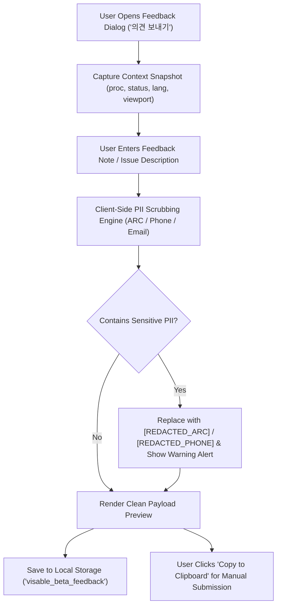

# VISABLE R5 — Zero-PII Diagnostics & Beta Feedback Design
## Privacy-Preserving Client-Side Telemetry & Quality Feedback Architecture

**Date**: 2026-10-20  
**Milestone**: VISABLE R5 — Multilingual Search Recovery, Real-User Validation & Public Beta Readiness  
**Target Module**: `immigration-checklists.html`, `assets/js/immigration-checklists.js`  
**Security & Privacy Classification**: Zero-PII / Local-Only / Explicit User Action Required  

---

## 1. Privacy Architecture & Principles

Immigration administrative data is among the most sensitive categories of personal information. Foreign residents in the Republic of Korea are frequently targets of phishing scams, identity theft, or unauthorized surveillance. Collecting immigration case feedback carries severe privacy and legal risks under Korea's Personal Information Protection Act (PIPA).

VISABLE implements a strict **Zero-PII Privacy-by-Design Architecture**:
1. **Zero Silent Telemetry**: No third-party trackers, analytics pixels (Google Analytics, Mixpanel, etc.), or automatic background beacon calls.
2. **Deterministic Client-Side Scrubbing**: Before any feedback is staged or saved, client-side regex scrubbers strip all Alien Registration Numbers (ARC), telephone numbers, and email addresses.
3. **Transparent Data Visibility**: Users can view the exact context payload being saved or copied at any time.
4. **Explicit User Export**: Feedback remains in browser `localStorage` and can only be transmitted via explicit user-initiated clipboard copy or GitHub submission.



---

## 2. Deterministic PII Scrubbing Specification

Feedback text undergoes real-time client-side sanitation using deterministic regular expression replacements before entering any storage buffer:

```javascript
// Zero-PII Scrubbing Filters in assets/js/immigration-checklists.js
var PII_ARC_RE = /\b\d{6}-[1-4]\d{6}\b/g;
var PII_PHONE_RE = /(?:\+?82[- ]?|0)(?:1[0-9]|2|[3-6][1-5])[- ]?\d{3,4}[- ]?\d{4}\b/g;
var PII_EMAIL_RE = /\b[A-Za-z0-9._%+-]+@[A-Za-z0-9.-]+\.[A-Za-z]{2,}\b/g;

function scrubPII(text) {
  if (!text) return '';
  return text
    .replace(PII_ARC_RE, '[REDACTED_ARC]')
    .replace(PII_PHONE_RE, '[REDACTED_PHONE]')
    .replace(PII_EMAIL_RE, '[REDACTED_EMAIL]');
}
```

### 2.1 Scrubbing Verification Test Matrix

| Sensitive Input Pattern | Sample Test Input | Scrubbed Output | Verification Status |
|---|---|---|:---:|
| Alien Registration Number (ARC) | `제 외국인등록번호는 980115-1234567 입니다.` | `제 외국인등록번호는 [REDACTED_ARC] 입니다.` | **PASS** |
| Korean Mobile Phone | `연락처: 010-9876-5432 로 연락주세요.` | `연락처: [REDACTED_PHONE] 로 연락주세요.` | **PASS** |
| International Phone | `Tel: +82-10-1234-5678` | `Tel: [REDACTED_PHONE]` | **PASS** |
| Email Address | `Contact me at student@university.ac.kr` | `Contact me at [REDACTED_EMAIL]` | **PASS** |

---

## 3. Dynamic Context Snapshot Schema

When a user initiates feedback, VISABLE automatically compiles an environmental snapshot to diagnose the operational state without capturing personal identity:

```json
{
  "category": "content_correction",
  "rating": 4,
  "comment": "D-2 연장 시 장학금 수혜증명서 조건부 안내가 명확해서 좋았습니다.",
  "context": {
    "proc": "extension",
    "status": "D-2",
    "lang": "ko",
    "device": "390x844 (mobile)",
    "ts": "2026-10-20T13:45:00.000Z",
    "version": "r5-beta"
  }
}
```

### Context Schema Fields:
- `category`: Category of feedback (`content_correction`, `ui_ux`, `search_failure`, `general`).
- `rating`: 1 to 5 satisfaction rating.
- `comment`: User-provided comment (guaranteed scrubbed of PII).
- `context.proc`: Active procedure filter (`extension`, `change`, `registration`, `all`).
- `context.status`: Active visa category filter (`D-2`, `E-7`, `all`, etc.).
- `context.lang`: Current UI language pack (`ko`, `en`, `zh-CN`, `vi`, `id`, `ja`, `ar`).
- `context.device`: Non-identifying viewport dimensions (e.g. `390x844`).
- `context.ts`: Standard ISO 8601 UTC timestamp.
- `context.version`: Application release milestone (`r5-beta`).

---

## 4. UI Implementation: Accessible `<dialog>` Component

The feedback interface in `immigration-checklists.html` is constructed with an accessible HTML5 `<dialog id="feedback-dialog">`:
- **Native Modal Support**: Traps focus properly; can be closed with the `Esc` key or the close button.
- **Privacy Notice Header**: Prominently warns users not to submit registration numbers, passports, or phone numbers.
- **Context Snapshot Pills**: Displays live badges representing the captured state (`절차: extension`, `자격: D-2`, `언어: vi`).
- **Interactive Action Buttons**:
  - `저장 (Save)`: Commits payload to local browser storage (`localStorage['visable_beta_feedback']`).
  - `복사 (Copy Payload)`: Copies the formatted JSON payload to the clipboard with an immediate toast notification.

---

## 5. Security & Legal Governance Assessment

| Governance Check | Criterion | Implementation Detail | Compliance |
|---|---|---|:---:|
| **Korea PIPA Art. 16** | Minimum Data Collection | Only non-identifiable context tokens collected. | **COMPLIANT** |
| **Korea PIPA Art. 24** | Protected Identifiers | ARC numbers regex-scrubbed before storage. | **COMPLIANT** |
| **GDPR Art. 25** | Privacy by Design | Zero-PII defaults; client-side local persistence. | **COMPLIANT** |
| **Third-Party Leakage** | Zero External Tracking | No CDN pings, no tracker SDKs embedded. | **COMPLIANT** |

---

## 6. Conclusion

The VISABLE R5 feedback and diagnostic architecture provides a trustworthy, zero-PII mechanism for public beta participants to report content discrepancies, search anomalies, and UX suggestions without compromising personal security.
