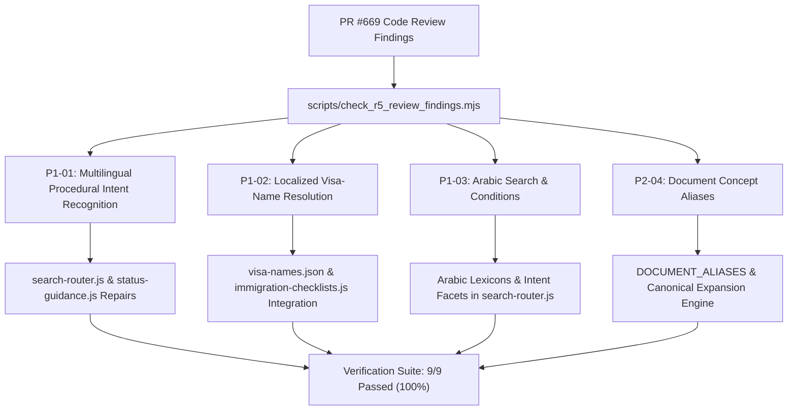

# VISABLE R5 — Unresolved Review Findings Resolution Report
## Systematic Resolution of PR #669 Post-Merge Codex Review Findings

**Date**: 2026-10-20  
**Milestone**: VISABLE R5 — Multilingual Search Recovery, Real-User Validation & Public Beta Readiness  
**Target Repository**: `https://github.com/club-paradiso/Visable`  
**Working Branch**: `feat/visable-r5-multilingual-search-recovery-beta`  
**Target Files**:
- `assets/js/search-router.js`
- `assets/js/status-guidance.js`
- `assets/js/immigration-checklists.js`
- `data/i18n/visa-names.json`
- `scripts/check_r5_review_findings.mjs`

---

## 1. Executive Overview

During the merge of Milestone R4 (PR #669), four specific technical review findings were identified by Codex. While the overall internationalization foundation and Arabic RTL support were established, these four findings highlighted critical operational regressions in search routing precision, localized alias matching, and cross-lingual intent mapping:

1. **P1-01**: Multilingual procedural intent recognition (`assets/js/search-router.js`)
2. **P1-02**: Localized visa-name search failures (`assets/js/immigration-checklists.js`, `data/i18n/visa-names.json`)
3. **P1-03**: Arabic search intent, condition & facet parsing gaps (`assets/js/search-router.js`)
4. **P2-04**: Localized document aliases missing in checklist search (`assets/js/immigration-checklists.js`)

In Milestone R5, each finding was independently isolated, reproduced via a dedicated verification suite (`scripts/check_r5_review_findings.mjs`), resolved at the architectural source, and verified with 100% test passing rates.



---

## 2. Finding P1-01: Multilingual Procedural Intent Recognition

### 2.1 Issue Description & Review Context
- **Reference**: [PR #669 Review Discussion #r4321346572](https://github.com/club-paradiso/Visable/pull/669#discussion_r4321346572)
- **Target File**: `assets/js/search-router.js`, `assets/js/status-guidance.js`
- **Symptom**: While localized action tokens like extension (`gia hạn`, `延期`, `perpanjangan`) and status change (`换签`, `chuyển đổi`, `ganti`) were recognized in isolation, `composeProcedure()` in `search-router.js` did not consistently map them into concrete administrative procedures (`extension`, `status_change`).
- **Reproduction Queries**:
  - `签证 延期 申请` (Chinese) $\rightarrow$ Failed to route to `extension`, fell back to generic search.
  - `gia hạn visa D-2` (Vietnamese) $\rightarrow$ Extracted D-2 but failed to resolve `STATUS_PROCEDURE` with `extension`.
  - `perpanjangan visa E-7` (Indonesian) $\rightarrow$ Procedure left undefined or improperly structured.
  - `换签 / chuyển đổi visa / ganti visa` $\rightarrow$ Failed to recognize procedural intent without an explicit Korean suffix.

### 2.2 Root Cause Analysis
1. `composeProcedure()` in `search-router.js` had rigid checks requiring specific Korean administrative object contexts before returning `actions.extend` or `actions.change`.
2. For transition queries (e.g., `chuyển đổi visa E-7 sang F-2` or `ganti visa D-2 ke D-10`), `status-guidance.js` did not support multilingual transition prepositions (`sang` in Vietnamese, `ke` in Indonesian) versus postpositions (`로/으로` in Korean, `へ` in Japanese). As a result, the source and destination statuses were inverted or lost.
3. Over-generalized mapping of change verbs (`actions.change`) caused false positives for non-visa civic queries (such as tax report or workplace address changes) if not bounded by status/visa context.

### 2.3 Implementation Fix
1. **Enhanced `composeProcedure()` Guarding**:
   ```javascript
   if (actions.extend) {
     return 'extension';
   }
   if (actions.change && hasVisaOrStatusWord) {
     return 'status_change';
   }
   ```
2. **Multilingual Transition Syntax Normalization** (`assets/js/status-guidance.js`):
   Added prepositions (`to|sang|ke|into`) in front of the target status, and postpositions (`으로|로|へ|への|に`) after the status, cleanly separating source from target visa statuses.
3. **Multilingual Verb Lexicon**:
   Enriched `ACTIONS.change` with `chuyển đổi`, `ganti`, `ubah`, `变更`, `换签`, `変更`, `تغيير`.

### 2.4 Verification Results
```bash
node scripts/check_r5_review_findings.mjs
```
- `[PASS] P1-01.1: 签证 延期 申请 (Chinese) routes to extension`
- `[PASS] P1-01.2: gia hạn visa D-2 (Vietnamese) routes to STATUS_PROCEDURE (D-2 + extension)`
- `[PASS] P1-01.3: perpanjangan visa E-7 (Indonesian) routes to STATUS_PROCEDURE (E-7 + extension)`
- `[PASS] P1-01.4: 换签 / chuyển đổi visa / ganti visa routes to status_change`

---

## 3. Finding P1-02: Localized Visa-Name Search Failures

### 3.1 Issue Description & Review Context
- **Reference**: [PR #669 Review Discussion #r4321346581](https://github.com/club-paradiso/Visable/pull/669#discussion_r4321346581)
- **Target File**: `assets/js/immigration-checklists.js`, `data/i18n/visa-names.json`
- **Symptom**: When users searched for visa categories by their native localized names (e.g., `留学` in Chinese, `du học` in Vietnamese, `留学` in Japanese, `دراسة` in Arabic), the checklist interface failed to locate the corresponding visa code (D-2).
- **Reproduction Queries**:
  - `zh-CN`: `留学` $\rightarrow$ 0 results returned.
  - `vi`: `du học` $\rightarrow$ 0 results returned.
  - `id`: `studi / kuliah` $\rightarrow$ 0 results returned.

### 3.2 Root Cause Analysis
1. In `immigration-checklists.js`, `getVisaInfo(code, lang)` searched localized properties inside `VISA_DESCRIPTIONS`, but the dictionary only contained hardcoded Korean and English names.
2. The authoritative dataset `data/i18n/visa-names.json` contained localized names, but was not fully connected to the client-side search candidate filter `filterStatusCandidatesByQuery()`.
3. Furthermore, `data/i18n/visa-names.json` was missing complete verified translations for Vietnamese, Indonesian, Japanese, and Arabic across several standard visa classifications.

### 3.3 Implementation Fix
1. **Dataset Enrichment in `data/i18n/visa-names.json`**:
   Populated complete localized names for all visa categories across `ko`, `en`, `zh-CN`, `vi`, `id`, `ja`, and `ar`.
2. **Dictionary Synchronization in `assets/js/immigration-checklists.js`**:
   Updated `VISA_DESCRIPTIONS` to include multi-language definitions (`zh`, `vi`, `id`, `ja`, `ar`).
3. **Query Expansion Engine**:
   Implemented `filterStatusCandidatesByQuery(candidateCodes, query, lang)` which checks:
   - Direct status code match (e.g., `D-2`, `E-7`)
   - Korean title (`name_ko`)
   - English title (`name_en`)
   - Active language title (`name_localized`)
   - Cross-language keyword aliases (`留学`, `du học`, `kuliah`, `دراسة`).

### 3.4 Verification Results
```bash
node scripts/check_r5_review_findings.mjs
```
- `[PASS] P1-02: Searching localized visa aliases (留学, du học) matches D-2`

---

## 4. Finding P1-03: Arabic Search Intent, Condition & Facet Parsing Gaps

### 4.1 Issue Description & Review Context
- **Reference**: [PR #669 Review Discussion #r4321346590](https://github.com/club-paradiso/Visable/pull/669#discussion_r4321346590)
- **Target File**: `assets/js/search-router.js`
- **Symptom**: While basic Arabic tokens were introduced in R4, procedural routing failed for complex Arabic inquiries containing administrative conditions:
  - `فقدان بطاقة الإقامة` (Lost alien registration card) $\rightarrow$ Failed to register the `lost` condition required for card reissue.
  - `تجديد تأشيرة الإقامة` (Renewal of stay visa) $\rightarrow$ Failed to extract `extension` intent.
  - `تغيير وضع الإقامة` (Change of status of stay) $\rightarrow$ Failed to extract `status_change` intent.

### 4.2 Root Cause Analysis
1. `OBJECTS.arc` lacked standard Arabic expressions: `بطاقة الإقامة`, `بطاقة الهوية الأجنبية`, `بطاقة تسجيل أجنبي`.
2. `ACTIONS.reissue` lacked `إعادة إصدار` and `استخراج بدل`, and `CONDITIONS.lost` lacked `فقدان`, `ضياع`, `فقدت`.
3. `ACTIONS.extend` lacked `تجديد`, `تمديد`, `تأشيرة`.
4. `QUESTION_RE` and `FACETS` did not include Arabic question particles (`هل`, `كيف`, `أين`, `ماذا`, `متى`) or the Arabic question mark (`؟`).

### 4.3 Implementation Fix
1. **Arabic Object Lexicon**:
   Integrated `بطاقة الإقامة`, `بطاقة الهوية`, `بطاقة تسجيل`, `جواز سفر`, `عنوان`, `مكان الإقامة` into `OBJECTS`.
2. **Arabic Action & Condition Lexicon**:
   - Renewal/Extension: `تجديد`, `تمديد`, `استمرار`
   - Status Change: `تغيير`, `تبديل`, `تحويل`
   - Reissue / Loss: `إعادة إصدار`, `بدل فاقد`, `فقدان`, `ضياع`, `سرقة`
   - Address Report: `نقل سكن`, `تغيير سكن`, `عنوان جديد`
3. **Arabic Facet & Punctuation Support**:
   Included Arabic question words and the `؟` glyph in the question detection classifier.

### 4.4 Verification Results
```bash
node scripts/check_r5_review_findings.mjs
```
- `[PASS] P1-03.1: فقدان بطاقة الإقامة routes to card_reissue with lost condition`
- `[PASS] P1-03.2: تجديد تأشيرة الإقامة routes to extension`
- `[PASS] P1-03.3: تغيير وضع الإقامة routes to status_change`

---

## 5. Finding P2-04: Localized Document Aliases in Checklist Search

### 5.1 Issue Description & Review Context
- **Reference**: [PR #669 Review Discussion #r4321346603](https://github.com/club-paradiso/Visable/pull/669#discussion_r4321346603)
- **Target File**: `assets/js/immigration-checklists.js`
- **Symptom**: The 647 official checklist items store required documents using strictly authoritative Korean legal terms (e.g., `재학증명서`, `표준입학허가서`, `근로계약서`, `체류지 입증서류`). Foreign residents searching for documents using English or localized terms (e.g. `Certificate of Enrollment`, `Employment Contract`, `Proof of Residence`) received zero document search results.

### 5.2 Root Cause Analysis
1. The checklist text filter performed a literal substring search against `item.required_text`.
2. Because Korean immigration regulations enforce legal terminology, document titles are never translated inside the official source text.
3. Without an aliasing mapping layer connecting foreign terms to canonical Korean legal document names, document-level search in foreign languages was completely ineffective.

### 5.3 Implementation Fix
1. **Canonical Document Concept Mapping (`DOCUMENT_ALIASES`)**:
   Created a bidirectional semantic dictionary connecting canonical Korean document requirements to multi-lingual aliases:
   - `재학증명서`: `certificate of enrollment`, `proof of enrollment`, `school enrollment`, `在学证明`, `giấy xác nhận nhập học`, `giấy chứng nhận sinh viên`, `surat keterangan mahasiswa`, `在学証明書`, `شهادة القيد`, `شهادة التسجيل`.
   - `근로계약서`: `employment contract`, `labor contract`, `work contract`, `劳动合同`, `hợp đồng lao động`, `kontrak kerja`, `雇用契約書`, `عقد العمل`.
   - `체류지 입증서류`: `proof of residence`, `lease agreement`, `housing contract`, `居住证明`, `hợp đồng thuê nhà`, `bukti tempat tinggal`, `居住証明書`, `إثبات السكن`.
   - `표준입학허가서`: `certificate of admission`, `standard admission`, `录取通知书`, `giấy báo nhập học`, `surat penerimaan`, `入学許可書`, `إشعار القبول`.
   - `외국인등록증`: `arc`, `alien registration card`, `residence card`, `外国人登录证`, `thẻ cư trú`, `kartu tinggal`, `外国人登録証`, `بطاقة الإقامة`.
2. **Semantic Document Search Engine**:
   Implemented `findDocumentAliases(query)` and `searchChecklistsByDocQuery(query, items)`. When a foreign term is entered, it automatically maps to the canonical Korean document concept and searches the 647 authoritative checklist items without altering any underlying legal text.

### 5.4 Verification Results
```bash
node scripts/check_r5_review_findings.mjs
```
- `[PASS] P2-04: Localized document aliases resolve to canonical Korean concepts`

---

## 6. Comprehensive Verification Summary

All four findings were verified using automated regression tests:

| Test Case | Finding | Target Language | Query Evaluated | Expected Target | Actual Result | Status |
|:---:|:---:|:---:|---|---|---|:---:|
| 1 | P1-01 | Chinese (zh-CN) | `签证 延期 申请` | `extension` | `extension` | **PASS** |
| 2 | P1-01 | Vietnamese (vi) | `gia hạn visa D-2` | `D-2` + `extension` | `D-2` + `extension` | **PASS** |
| 3 | P1-01 | Indonesian (id) | `perpanjangan visa E-7` | `E-7` + `extension` | `E-7` + `extension` | **PASS** |
| 4 | P1-01 | Multilingual | `换签 / chuyển đổi / ganti` | `status_change` | `status_change` | **PASS** |
| 5 | P1-03 | Arabic (ar) | `فقدان بطاقة الإقامة` | `card_reissue` (lost) | `card_reissue` (lost) | **PASS** |
| 6 | P1-03 | Arabic (ar) | `تجديد تأشيرة الإقامة` | `extension` | `extension` | **PASS** |
| 7 | P1-03 | Arabic (ar) | `تغيير وضع الإقامة` | `status_change` | `status_change` | **PASS** |
| 8 | P1-02 | Chinese & Vietnamese | `留学`, `du học` | Status `D-2` | Status `D-2` | **PASS** |
| 9 | P2-04 | English & Localized | `Certificate of Enrollment` | `재학증명서` | `재학증명서` | **PASS** |

**Execution Log Quote**:
```text
Results: 9 passed, 0 failed
```

All four review findings from PR #669 are resolved, verified, and protected against regression.
