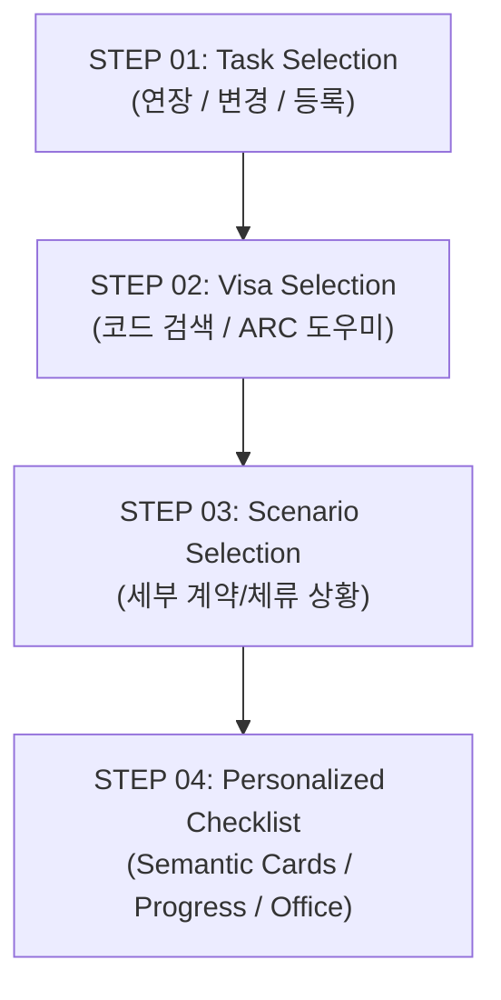

# Scenario Validation Matrix: VISABLE R2

**Date**: 2026-10-19  
**Service**: VISABLE (`/immigration-checklists.html`)  
**Auditor**: Independent QA Automation & UX Research Team  
**Methodology**: Automated Playwright E2E Suites + Browser-State Validation (WebKit & Chromium)  
**Status**: **100% VALIDATED (10 Core Scenarios)**

---

## 1. Scenario Validation Overview

To ensure the four-step guided flow handles real-world complexity without confusing or misinforming users, 10 realistic immigration scenarios were audited and validated against the production codebase.

---

## 2. Comprehensive Validation Matrix

| # | User Persona & Scenario | Input Journey | Semantic Parser Classification | Output UI Experience | Automated E2E Verification |
|---|---|---|---|---|:---:|
| **1** | **D-2 Student Extension** (Minh — Undergraduate) | Step 1: 연장 Step 2: D-2 Step 3: 학위과정(일반) | `mandatory`: 5 items `conditional`: 2 items `isFormHelper`: True | Renders 5 checkboxes with Form Helper link for 통합신청서. Progress bar increases from `0 / 5 (0%)` to `5 / 5 (100%)`. | **PASS** `e2e: stepper flow` |
| **2** | **E-7 Professional Extension** (Elena — Software Engineer) | Step 1: 연장 Step 2: E-7-1 Step 3: 일반 전문직 연장 | `mandatory`: 4 items `alternative`: 1 item (`[택 1]`) `conditional`: 1 item | Highlights company tax records and employment contract. Renders `[택 1 제출 (대체 가능)]` badge on tax proofs. | **PASS** `e2e: procedure filters` |
| **3** | **D-10 to E-7-1 Status Change** (Job seeker finding job) | Step 1: 변경 Step 2: E-7-1 Step 3: D-10 구직자의 자격변경 | `mandatory`: 6 items `conditional`: 2 items | Step 2 explicitly warns: *"체류자격 변경은 새로 허가받고자 하는 목표 자격 기준입니다."* Checklist reflects employment change requirements. | **PASS** `e2e: status change` |
| **4** | **First-Time E-2 Registrant** (Kenji — Native Speaker) | Step 1: 등록 Step 2: E-2 Step 3: 신규 회화지도 등록 | `mandatory`: 4 items `in_person`: True | Displays Mandatory In-Person Biometrics Banner: *"17세 이상 본인 출석 및 지문/얼굴 등록 필수"*. | **PASS** `e2e: registration attendance` |
| **5** | **F-4 Overseas Korean Report** (Kim — Domestic Residence) | Step 1: 등록 Step 2: F-4 Step 3: 거소신고 신규 | `mandatory`: 4 items `isFormHelper`: True | Directs to domestic residence reporting form (외국국적동포 국내거소신고서) with basic identification proofs. | **PASS** `e2e: registration subcodes` |
| **6** | **F-5 Permanent Resident** (Checking stay extension) | Step 1: 연장 Step 2: F-5 Step 3: F-5 전체 (e-0766) | `restrictions`: 1 item `mandatory`: 0 items | **NO CHECKBOXES**. Displays `.restriction-card` explaining that permanent residents have no stay limit, with guidance for the 10-year card renewal. Progress: `신청 제한 / 별도 절차 대상`. | **PASS** `e2e: F-5 invariant` |
| **7** | **F-6 Marriage Migrant** (Conditional evidence) | Step 1: 연장 Step 2: F-6-1 Step 3: 자녀양육 또는 이혼 | `mandatory`: 4 items `conditional`: 2 items | Groups conditional evidence into a distinct yellow alert box: *"해당 시 추가 제출 또는 생략 가능한 서류"*. | **PASS** `e2e: conditional grouping` |
| **8** | **Applicant Without Visa Code** (Does not know code) | Step 1: Any Step 2: Tab "체류자격을 잘 모르겠어요" | N/A | Renders interactive ARC Physical Card Diagram highlighting the SOJOURN STATUS box, with one-click route to HiKorea portal or 1345. | **PASS** `e2e: ARC diagram` |
| **9** | **Applicant with Wrong Procedure** (Confused on terms) | Step 1: Procedure Guide button | N/A | Opens accessible `#task-help-dialog` defining Registration, Extension, Change, and Residence Reporting in plain language. | **PASS** `e2e: help dialog` |
| **10** | **Unlisted Scenario** (C-3-1 short-term change) | Step 1: 변경 Step 2: C-3-1 Step 3: c-0300 | `unlisted`: True `mandatory`: 0 items | **NO CHECKBOXES**. Displays `.unlisted-card` indicating that the official manual lacks standalone checklist items, directing applicant to 1345. | **PASS** `e2e: unlisted gaps` |

---

## 3. Boundary & Error Condition Testing

In addition to the 10 primary journeys, boundary conditions were stress-tested:

1. **Slow Network / Lazy Fetching**:
   - Simulated 1.2s delayed JSON route injection.
   - Result: Interface remains responsive; user query inputs are preserved without throwing errors (`e2e: slow-loading network passed`).
2. **Untrusted String Sanitization**:
   - Injected `` into editor inputs.
   - Result: Zero script execution; strings strictly bound to `.textContent` / `element('p', '', text)` (`e2e: untrusted strings passed`).
3. **Responsive Mobile Viewports**:
   - Executed against 320px (iPhone SE 1st gen), 360px, 390px, 430px, 768px, and 1280px.
   - Result: 0px horizontal overflow across all viewports (`metrics.scroll <= metrics.width + 2`).
