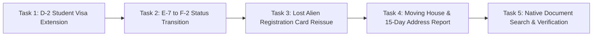

# VISABLE R5 — Usability Participant Tasks
## Standardized User Task Scenarios for Controlled Public Beta Evaluation

> [!IMPORTANT]
> **DATA COLLECTION STATUS: NOT YET COLLECTED — PUBLIC BETA PHASE**  
> These task scenarios are designed to be administered to real foreign resident participants during the live beta phase. All task completions, timing records, and user pathways will be gathered directly from public beta sessions.

---

## 1. Overview of Task Battery

The task battery consists of **five representative, high-stakes immigration scenarios** commonly encountered by foreign residents in South Korea. Each task tests specific capabilities of the VISABLE platform:

---

## 2. Detailed Task Scenarios

### Task 1: D-2 International Student Stay Extension
- **Scenario Context**: You are an international university student in Seoul holding a D-2 student visa. Your current stay expires in one month, and you need to extend your visa for the upcoming academic semester.
- **Starting State**: On the VISABLE home or checklist page; participant is free to use their native language (e.g., Vietnamese `vi`, Chinese `zh-CN`, English `en`, Korean `ko`).
- **Participant Prompt**:
  > *"Find the exact document checklist you need to extend your student visa in Korea. Identify which documents are mandatory for everyone, and check if you need any special financial documents."*
- **Success Criteria**:
  1. Locates `D-2 (유학)` under `체류기간 연장허가 (Extension of Stay)`.
  2. Identifies mandatory documents (`통합신청서`, `여권`, `외국인등록증`, `재학증명서`).
  3. Correctly identifies the conditional criteria for financial documents (tuition payment or bank balance certificate).
- **Critical Failure Criteria**:
  - Selecting status change (`체류자격 변경`) instead of extension (`체류기간 연장`).
  - Assuming conditional financial documents are required when tuition is already verified through the university system.
- **Optimal Path**: Type `gia hạn visa D-2` or `D-2 延期` in search $\rightarrow$ Select D-2 card $\rightarrow$ Review checklist.

---

### Task 2: E-7 Professional Worker Status Transition to F-2
- **Scenario Context**: You are a software developer on an E-7 visa. You have lived in Korea for 3 years, have earned sufficient points under the points-based residency system, and wish to switch to an F-2-7 residency visa.
- **Starting State**: Clean mobile view.
- **Participant Prompt**:
  > *"You want to change your visa status from your current work visa (E-7) to a resident visa (F-2). Find the checklist for this change and identify what employment and points calculation documents you must submit."*
- **Success Criteria**:
  1. Accesses `체류자격 변경허가 (Change of Status)`.
  2. Identifies `F-2 (거주)` as the target status.
  3. Locates requirement for points evaluation sheet (`점수제 평가표`) and employment contract (`근로계약서`).
- **Critical Failure Criteria**:
  - Inverting the transition (e.g., searching F-2 to E-7).
  - Failing to recognize that this is a change of status rather than an extension of stay.
- **Optimal Path**: Search `change status E-7 to F-2` or `chuyển đổi visa E-7 sang F-2` $\rightarrow$ Target procedure card $\rightarrow$ Inspect required points evaluation paperwork.

---

### Task 3: Lost Alien Registration Card Reissue
- **Scenario Context**: You lost your wallet containing your physical Alien Registration Card (ARC) while taking the subway yesterday. You need to replace your card immediately.
- **Starting State**: Search input focused.
- **Participant Prompt**:
  > *"You have lost your Alien Registration Card. Use VISABLE to find out what steps and documents are required to get a new card issued, how much the government fee is, and what report you must file."*
- **Success Criteria**:
  1. Routes to `외국인등록증 재발급 (Alien Registration Card Reissuance)`.
  2. Identifies the reason as `분실 (Loss)`.
  3. Confirms that a Loss Report (`분실신고서` or `분실확인서`) and passport photo are required.
  4. Notes the statutory processing fee (30,000 KRW).
- **Critical Failure Criteria**:
  - Selecting initial alien registration instead of reissuance.
  - Missing the requirement for a police loss report or loss declaration form.
- **Optimal Path**: Search `lost alien registration card` or `thẻ cư trú bị mất` or `فقدان بطاقة الإقامة` $\rightarrow$ Reissue procedure modal / checklist.

---

### Task 4: Moving House & 15-Day Residence Address Report
- **Scenario Context**: You just moved from your university dormitory into a new private studio apartment in Mapo-gu, Seoul. You signed a lease agreement 3 days ago.
- **Starting State**: Checklists view.
- **Participant Prompt**:
  > *"You recently moved to a new address. Find out what you are legally required to report to the immigration authorities, the strict statutory deadline for doing so, and what documents prove your new residence."*
- **Success Criteria**:
  1. Identifies the procedure: `체류지 변경신고 (Report of Change of Residence)`.
  2. Recognizes the **14/15-day statutory deadline** from the moving date.
  3. Identifies the lease agreement (`임대차계약서` or `체류지 입증서류`) as mandatory evidence.
  4. Discovers that this can be processed at either the local Community Service Center (주민센터) or Immigration Office.
- **Critical Failure Criteria**:
  - Failing to note the 14/15-day deadline (which results in administrative fines).
  - Assuming only the immigration office can process address changes.
- **Optimal Path**: Search `report address after moving` or `chuyển nhà khai báo địa chỉ` $\rightarrow$ Residence report guidance.

---

### Task 5: Native Document Search & Verification
- **Scenario Context**: Your HR department or school administrator told you in English that you need an "Employment Contract" and a "Certificate of Enrollment", but the immigration official will only accept Korean documents.
- **Starting State**: Checklists filter bar.
- **Participant Prompt**:
  > *"Search for 'Employment Contract' or 'Certificate of Enrollment' in your native language. Find out what these documents are called in Korean and copy the Korean name so you can request them from your employer or school."*
- **Success Criteria**:
  1. Types native/English document term (`Employment Contract`, `Hợp đồng lao động`, `在学证明`, `عقد العمل`).
  2. Search returns checklists containing `근로계약서` or `재학증명서`.
  3. Successfully clicks the copy button to retrieve the canonical Korean statutory term.
- **Critical Failure Criteria**:
  - Receiving zero search results due to untranslated Korean document names.
- **Optimal Path**: Enter document query into checklist search input $\rightarrow$ Canonical alias match expands $\rightarrow$ Instant highlight in checklist.

---

## 3. Post-Task Rating & Observation Metrics

Following each task, the participant answers two quick Likert questions:
1. *"It was easy to find the information I needed."* (1: Strongly Disagree $\leftrightarrow$ 5: Strongly Agree)
2. *"I am confident that this information is legally accurate."* (1: Strongly Disagree $\leftrightarrow$ 5: Strongly Agree)
