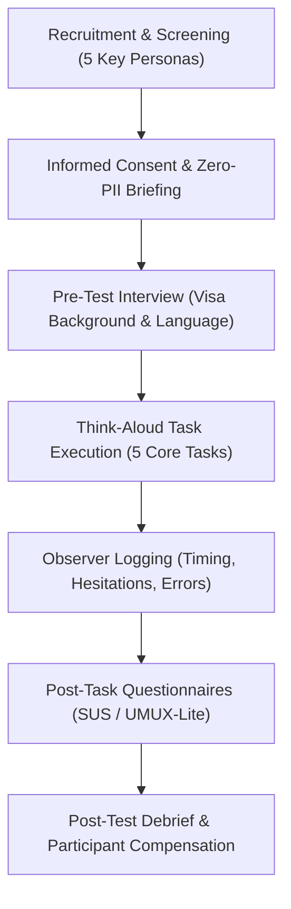

# VISABLE R5 — Usability Test Protocol
## Structured Testing Methodology for Controlled Public Beta Validation

> [!IMPORTANT]
> **DATA COLLECTION STATUS: NOT YET COLLECTED — PUBLIC BETA PHASE**  
> In strict accordance with engineering integrity and scientific ethics standards, **no participant session findings, synthetic quotes, or fabricated usability metrics are recorded in this document**. This protocol defines the formal, human-subject testing framework to be executed during the live public beta phase.

---

## 1. Research Objectives & Core Research Questions

The primary objective of this usability test is to empirically evaluate whether foreign residents in the Republic of Korea—with varying levels of Korean language proficiency and unfamiliarity with Korean immigration law—can independently and accurately determine their administrative requirements using VISABLE.

### Core Research Questions:
1. **Search & Discovery**: Can users locate their specific visa procedure within 60 seconds using their native language?
2. **Document Comprehension**: Can users accurately distinguish between **기본서류 (Mandatory Documents)** and **조건부 서류 (Conditional Documents)**?
3. **Actionability**: Can users identify their immediate next step (e.g. booking HiKorea, visiting district office, preparing bank balance statements)?
4. **Error Recovery & Feedback**: Can users successfully report a missing document or ambiguous instruction via the zero-PII feedback modal?

---

## 2. Participant Profiles & Recruitment Targets

Testing will engage **15–20 participants** across 5 distinct immigration personas:

### Persona Cohorts:

| Cohort ID | Persona Title | Primary Status | Target Native Languages | Korean Proficiency (CEFR / TOPIK) | Key Use Case |
|:---:|---|:---:|:---:|:---:|---|
| **P-01** | Undergraduate / Graduate Student | `D-2` | Vietnamese, Chinese, English | TOPIK 2–4 (Limited to Intermediate) | Semester stay extension, part-time work permit |
| **P-02** | Professional Foreign Specialist | `E-7` | English, Indonesian, Hindi | Beginner to TOPIK 2 (Low Korean) | Status transition to F-2 points visa |
| **P-03** | University Graduate Jobseeker | `D-10` | Chinese, Japanese, English | TOPIK 3–5 (Intermediate) | Internship reporting, extension of job-seeking stay |
| **P-04** | Marriage Migrant / Resident Family | `F-6` | Vietnamese, Tagalog, Thai | Conversational (Limited Legal Literacy) | Alien registration card reissue, child status extension |
| **P-05** | Non-Professional Worker / Other | `E-9` / `G-1` | Indonesian, Nepali, Arabic | Low Korean proficiency | Workplace change reporting, residence address report |

---

## 3. Ethical Consent & Zero-PII Data Protection

1. **Explicit Informed Consent**: Participants are briefed on the study goals, audio/screen recording, and right to withdraw at any moment without penalty.
2. **Strict Non-Collection of Personal Legal Documents**:
   - Participants are strictly instructed **never to input or reveal actual Alien Registration Numbers (ARC), passports, personal addresses, or bank statements**.
   - Dummy testing credentials (e.g. `Dummy ID: D2-TEST-2026`) are provided for any input exercises.
3. **Anonymization**: All field notes, observer sheets, and audio recordings are identified solely by subject tokens (e.g. `SUBJ-001-VI`).

---

## 4. Test Session Structure & Timeline (60 Minutes)

| Phase | Duration | Focus | Key Activities |
|---|:---:|---|---|
| **Phase 1** | 10 min | Welcome & Orientation | Consent form signing, device setup, explanation of "Think-Aloud" methodology. |
| **Phase 2** | 10 min | Pre-Task Interview | Participant immigration background, previous friction with immigration offices. |
| **Phase 3** | 25 min | Task Execution | Execution of 5 standardized tasks from `R5_PARTICIPANT_TASKS.md`. |
| **Phase 4** | 10 min | Quantitative Evaluation | Completion of System Usability Scale (SUS) and UMUX-Lite questionnaires. |
| **Phase 5** | 5 min | Debrief & Wrap-up | Open qualitative feedback, observer clarification, thank-you honorarium. |

---

## 5. Think-Aloud Methodology & Moderator Guidelines

Participants are asked to express their thoughts, hesitations, assumptions, and emotional reactions aloud while interacting with the platform.

### Moderator Directives:
- **Non-Intervention Rule**: Do not guide the user, explain Korean terms, or point out buttons, even if the user experiences navigation confusion.
- **Prompting Queries**: If the participant falls silent for more than 10 seconds:
  - *"What are you looking for right now?"*
  - *"What does this screen tell you?"*
  - *"What would you do next in a real immigration situation?"*
- **Recording Critical Incidents**: Immediately note any instance where a participant misidentifies a required document or fails to recognize a statutory deadline.

---

## 6. Success Metrics & Performance Benchmarks

The public beta usability evaluation targets the following quantitative thresholds:

1. **Unassisted Task Completion Rate**: $\ge 85\%$ across all personas.
2. **Mean Time-to-Checklist (TTC)**: $< 60\text{ seconds}$ from query entry to the relevant procedure card.
3. **Conditional Document Recognition Rate**: $\ge 90\%$ (participants explicitly recognizing that conditional documents only apply under specified criteria).
4. **System Usability Scale (SUS) Score**: Target $\ge 75$ (Grade B+ / "Good").
5. **Zero-PII Compliance**: $100\%$ of feedback submissions containing zero personal identity tokens.
